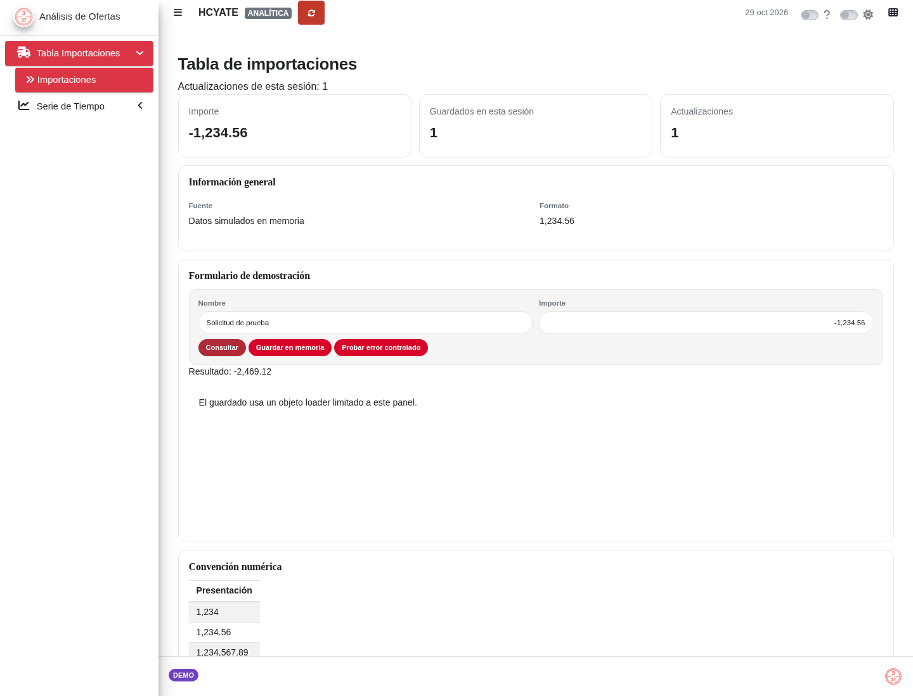
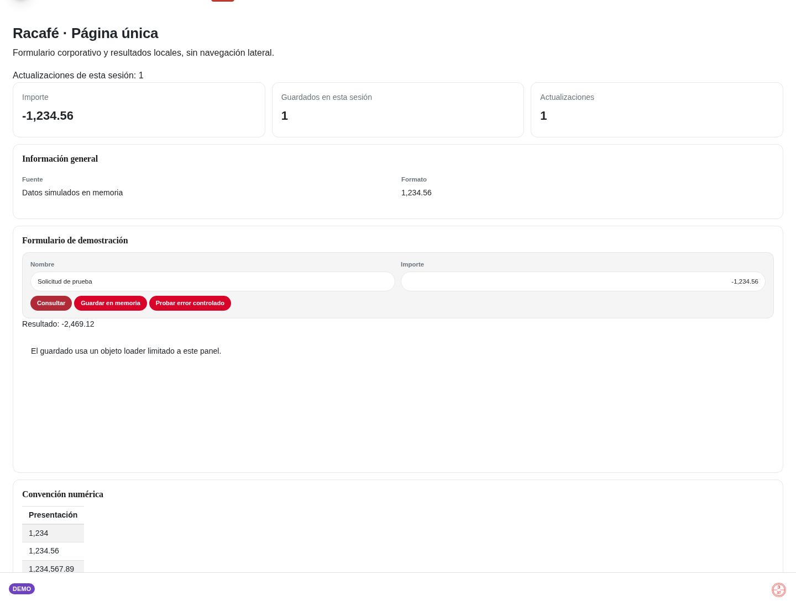

# PlantillaBs4Dash

Dos aplicaciones bs4Dash independientes con identidad visual Racafé y datos locales de demostración.

| Plantilla | Carpeta | Uso |
| --- | --- | --- |
| Dashboard | `APP` | Sidebar, navegación Importaciones/Histórico y controlbar |
| Single Page | `APP_SINGLE` | Página única, sin sidebar, botón lateral ni espacio reservado |

Ambas incluyen navbar con usuario/grupos, actualización funcional, badge de entorno,
footer, logo local, preloaders/loaders de racafeShiny y avisos de racafeForms.
El formulario hace cálculos y guardados solo en memoria; no usa APIs, bases de datos ni correos.




Capturas móviles: [Dashboard](docs/dashboard-mobile.png) · [Single Page](docs/single-mobile.png).

## Dependencias e instalación

R >= 4.1.0, Git para las descargas, `shiny`, `bs4Dash`, `stringr`, `later`, y los paquetes
corporativos `racafeCore`, `racafeShiny >= 1.2.0` y `racafeForms >= 0.5.0`.
Las dependencias transitivas, incluido waiter, se instalan mediante los paquetes corporativos.
Ya no se cargan racafeBD, racafeDrive, racafeForecast o tidyverse completo: estas demos no los utilizan.

```r
if (!requireNamespace("remotes", quietly = TRUE)) install.packages("remotes")
install.packages(c("shiny", "bs4Dash", "stringr", "later"))
repo <- "HCamiloYateT/Libreria-Racafe"
remotes::install_github(repo, subdir = "racafeCore", dependencies = NA, upgrade = "never")
remotes::install_github(repo, subdir = "racafeGraph", dependencies = NA, upgrade = "never")
remotes::install_github(repo, subdir = "racafeShiny", dependencies = NA, upgrade = "never")
remotes::install_github(repo, subdir = "racafeForms", dependencies = NA, upgrade = "never")
```

Si la versión 1.2.0 todavía está pendiente de integrar en main, instale racafeShiny con
`ref = "codex/shiny-loader-operations"`. Reinicie R y la app después de actualizar.
Autentique el acceso a repositorios privados fuera del código; no guarde tokens en el proyecto.

La copia local de recursos públicos de Compartido 1.1.0 está dentro de cada app, en
`www/compartido`, para que cada descarga sea independiente. Se carga mediante
`racafeForms::racafeSharedAssets()` una sola vez, sin descargar CSS, imágenes ni scripts al arrancar.
El logo de los loaders procede del paquete racafeShiny. No se reimplementan esos componentes.
Para actualizar Compartido, sustituya la copia completa de recursos de cada plantilla desde
una misma revisión y conserve su manifiesto `ASSETS_VERSION`; no mezcle versiones.

## Descargar una plantilla

### Función reutilizable

Desde un clon de este repositorio:

```r
source("utils/descargar_plantilla.R")
DescargarPlantillaBs4Dash("dashboard", destino = getwd()) # crea APP
DescargarPlantillaBs4Dash("single", destino = getwd())    # crea APP_SINGLE
```

Sin clonar el repositorio primero:

```r
archivo <- tempfile(fileext = ".R")
download.file(paste0("https://raw.githubusercontent.com/HCamiloYateT/PlantillaBs4Dash/",
                     "main/utils/descargar_plantilla.R"), archivo, mode = "wb")
source(archivo)
unlink(archivo)
DescargarPlantillaBs4Dash(tipo = "single", destino = getwd())
```

`destino` debe ser un directorio existente. La función comprueba Git, rechaza carpetas
preexistentes, valida la descarga y publica una copia completa desde una carpeta temporal.
No borra proyectos ni los sobrescribe. Limpia sus temporales y devuelve la ruta final.
`repo` y `ref` permiten elegir un origen o revisión; durante la revisión de este cambio use
`ref = "codex/two-corporate-templates"`.

### Sparse checkout manual: Dashboard

En una terminal, elija un nombre temporal que no exista:

```sh
git clone --depth=1 --filter=blob:none --sparse --no-checkout --single-branch \
  https://github.com/HCamiloYateT/PlantillaBs4Dash.git plantilla-dashboard-tmp
git -C plantilla-dashboard-tmp sparse-checkout set --no-cone /APP/
git -C plantilla-dashboard-tmp checkout
```

La aplicación está en `plantilla-dashboard-tmp/APP`. Puede ejecutarla ahí o copiar
esa carpeta a un destino nuevo. No copie encima de un proyecto existente.

### Sparse checkout manual: Single Page

```sh
git clone --depth=1 --filter=blob:none --sparse --no-checkout --single-branch \
  https://github.com/HCamiloYateT/PlantillaBs4Dash.git plantilla-single-tmp
git -C plantilla-single-tmp sparse-checkout set --no-cone /APP_SINGLE/
git -C plantilla-single-tmp checkout
```

La aplicación está en `plantilla-single-tmp/APP_SINGLE`. Antes del merge, añada
`--branch codex/two-corporate-templates` a `git clone` en cualquiera de los ejemplos.
El filtro solicita solo los blobs seleccionados; un servidor Git que no admita clones
parciales puede transferir más objetos. La copia final contiene únicamente la app elegida.

## Ejecutar cada aplicación

Desde la raíz del repositorio o de la descarga que contiene la carpeta correspondiente:

```r
shiny::runApp("APP")
# En otra sesión, o después de detener la anterior:
shiny::runApp("APP_SINGLE")
```

Cada app contiene su propio global, UI, servidor, módulos y recursos; ninguna referencia
a la otra carpeta. Si abrió directamente la carpeta de una app, ejecute `shiny::runApp(".")`.

## Estructura

```text
APP/                         APP_SINGLE/
  global.R                     global.R
  ui.R                         ui.R
  server.R                     server.R
  misc/                        misc/
    functions.R                  functions.R
    parametros.R                 parametros.R
    values.R                     values.R
    modules/demo.R               modules/demo.R
    modules/.gitkeep              modules/.gitkeep
    ui/                          ui/
      header.R                     header.R
      body.R                       body.R
      footer.R                     footer.R
      preloader.R                  preloader.R
      sidebar.R
      controlbar.R
  www/                         www/
    template.css                 template.css
    compartido/                  compartido/
utils/descargar_plantilla.R
```

## Personalización y módulos

- `misc/parametros.R`: título (`tit_app`) y badge (`badge_estado`). Se admiten prototipo,
  pruebas, staging, produccion, demo, mantenimiento y ninguno.
- `misc/ui/header.R` y `footer.R`: identidad y disposición. `.logo_url` apunta al logo
  publicado por racafeSharedAssets; puede sustituirlo por una imagen local en `www/`.
- `misc/ui/body.R`: contenido de la página y registro declarativo de loaders.
- `misc/modules/`: funciones `moduleUI`/`moduleServer`; use `NS(id)` y IDs locales.
  `racafeCore::load_modules()` conserva la carga modular y detecta scripts fallidos.
  El módulo `demo.R` muestra la estructura y las llamadas a componentes públicos.
- `APP/misc/ui/sidebar.R`: añada entradas con un `tabName` igual al de su `bs4TabItem`.
  `APP_SINGLE` no requiere sidebar ni pestañas.

En `server.R`, invoque el servidor del módulo una sola vez por sesión y añada su UI en
el body. La carga opcional de `data/data.RData` se conserva. Mantenga los datos de cada sesión en reactivos; no guarde datos de usuarios en global.

## Loaders y notificaciones

El preloader inicial se crea en `ui.R` con `racafeShiny::racafePreloader("inicio")`.
En el body se instala una sola vez `racafeLoaderUI(startup = FALSE, busy = TRUE, ...)`.
No se duplica `use_waiter()`. Los aliases de `misc/ui/preloader.R` solo llaman al paquete.

Se registran botones con acción real: `BTN_Actualizar`, consulta, guardado y error del
módulo. Use nombres de operaciones como `consultar`, `guardar`, `generar` o `enviar` para
nuevos triggers. Con módulos, use el ID completo o pase `ns`; evite duplicar namespaces.

El guardado demuestra un objeto `racafeLoader(..., type = "guardar", id = "panel")`,
con `show()`, `hide()` y limpieza mediante `on.exit()`/`finally`. Un temporizador local de
0.8 segundos permite observarlo antes de terminar o fallar. No es procesamiento paralelo.
Los procesos síncronos que bloquean R no ofrecen progreso intermedio fiable; la animación
no implica porcentajes reales. Para tareas asíncronas cierre al resolver y al rechazar.
Los resultados usan `racafeForms::racafeNotify()` y permanecen visibles al cerrar el loader.

## Usuario y grupos

`session$user` se presenta en `output$user`. `session$groups` (plural) se limpia,
convierte a mayúsculas, elimina vacíos/NA y une grupos únicos con ` · ` en `output$group`.
Sin identidad/grupos se muestran HCYATE y ANALÍTICA. Es información visual, no autorización:
los permisos de operaciones deben implementarse aparte en el servidor de cada proyecto.

## Convención numérica y fechas

Ambas apps usan `OutDec = "."`, `scipen = 999`, miles `,` y decimales `.`.
Los inputs y cálculos permanecen numéricos; el formato se aplica solo en outputs mediante
racafeShiny o `format(..., big.mark = ",", decimal.mark = ".")`. La demo verifica
`1,234`, `1,234.56`, `1,234,567.89`, `-1,234,567.89` y `0.125`.
No se modifica `LC_NUMERIC`. Los locales de fechas/mensajes siguen en español; si el sistema
no dispone de ellos, `format_fecha_es()` muestra fechas en español sin depender del locale.

## Validación y contribuciones

```sh
Rscript tests/test-templates.R
```

Inicie ambas apps y ejecute el test de navegador con Playwright instalado según
`tests/browser/package.json`:

```sh
DASHBOARD_URL=http://127.0.0.1:3922 SINGLE_URL=http://127.0.0.1:3923 \
  node tests/browser/test-templates.cjs
```

El test admite `CHROMIUM_PATH`, `NODE_PATH` y `CI=1`. Genera las capturas de `docs/`.
Consulte [CONTRIBUTING.md](CONTRIBUTING.md) y el [informe de validación](docs/validacion.md).
`.Rprofile` conserva la activación opcional de renv; no hay un lockfile previo que restaurar.
Si utiliza renv en su proyecto derivado, inicialícelo y genere su propio lockfile con las
versiones corporativas validadas, sin confirmar bibliotecas locales ni credenciales.
